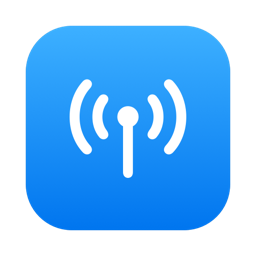

<p align="center"></p>

# SwiftDrop

**AirDrop-style sharing between Mac, iPhone, Android and Windows.** It's native on every
platform and compatible with the open [LocalSend v2 protocol](https://github.com/localsend/protocol),
so it also works with every device that already runs LocalSend (Linux included).

| | Mac | iPhone / iPad | Android | Windows |
|---|---|---|---|---|
| Tech | Swift + SwiftUI | Swift + SwiftUI | Kotlin + Compose | .NET 8 + WPF |
| Send from the system share menu | Finder ▸ Share ▸ SwiftDrop | Share sheet ▸ SwiftDrop | Share ▸ SwiftDrop | Explorer ▸ right-click ▸ Send with SwiftDrop |
| Receive with nothing open | ✅ menu bar app, starts at login | ⚠️ best effort: open SwiftDrop on the iPhone when it's been locked a while (see *Waking a locked iPhone*) | ✅ background service + Quick Settings tile | ✅ tray app, starts at login |
| Accept prompt | Notification-style banner | AirDrop-style card | Heads-up notification + card | Toast above the tray |
| Visibility | Off / Favorites / Everyone | Off / Favorites / Everyone | Off / Favorites / Everyone | Off / Favorites / Everyone |
| Size | 2.4 MB | 2.5 MB | 2 MB APK | 25 MB exe (incl. Windows Bluetooth bindings) |

Everything streams straight to disk, so files of any size and any format work. Folders keep their structure.
Transfers are encrypted (HTTPS with per-device self-signed certificates, like LocalSend).
Favourites can be set to auto-accept.

---

## Install

Download from the [latest release](../../releases/latest).

### Mac (macOS 14+)
1. Download `SwiftDrop-macOS.zip`, unzip, and drag **SwiftDrop.app** to **Applications**.
2. First launch: right-click the app ▸ **Open** ▸ **Open**. It's ad-hoc signed, not notarized.
   Or run `xattr -dr com.apple.quarantine /Applications/SwiftDrop.app`.
3. Allow **Local Network** when asked. SwiftDrop lives in the menu bar (📡 icon).
4. **Finder ▸ Share ▸ SwiftDrop**: if it's missing, enable it in System Settings ▸ General ▸
   Login Items & Extensions ▸ Sharing. Settings ▸ "Open at login" keeps it always available.

### Android (Android 10+)
1. Download `SwiftDrop-Android.apk` on the phone and open it (allow "Install unknown apps" for your browser).
2. Open SwiftDrop once, allow **Notifications**, and pick **Everyone** or **Favorites Only**.
   From then on it receives in the background and restarts after reboot. You don't need to open it again.
3. Optional: pull down Quick Settings ▸ edit ✏️ ▸ drag the **SwiftDrop** tile in. Tap it to turn receiving on or off.
4. To send, use **Share ▸ SwiftDrop** from any app (Photos, Files, Chrome…).

### Windows 10/11
1. Install the free [.NET 8 Desktop Runtime](https://dotnet.microsoft.com/download/dotnet/8.0)
   (`winget install Microsoft.DotNet.DesktopRuntime.8`).
2. Download `SwiftDrop-Windows-x64.zip` (or `-arm64`), unzip anywhere permanent, run **SwiftDrop.exe**,
   and allow it through the Windows Firewall (Private networks).
3. It registers itself (per-user, no admin rights) to start at login and adds **Send with SwiftDrop**
   to Explorer's right-click menu. On Windows 11 that's under *Show more options*.
   Click the tray icon for the AirDrop-style panel. Drop files on it to send.

### iPhone / iPad (iOS 17+)
Apple doesn't allow installing apps outside the App Store or Xcode, so build it yourself (free Apple ID is enough):
1. In Xcode ▸ Settings ▸ Accounts, sign in with your Apple ID. On the iPhone, turn on
   Settings ▸ Privacy & Security ▸ **Developer Mode** (it restarts; no data is erased).
2. Open `iOS/SwiftDrop.xcodeproj`. In **Build Settings** of the project, set `SWIFTDROP_BUNDLE_PREFIX` to something
   unique to you (e.g. `com.yourname`). Then pick your **Team** under Signing & Capabilities for both targets.
   Or build from Terminal:
   `xcodebuild -project iOS/SwiftDrop.xcodeproj -scheme SwiftDrop -destination 'id=<iPhone UDID>' -allowProvisioningUpdates DEVELOPMENT_TEAM=<team> SWIFTDROP_BUNDLE_PREFIX=com.yourname build`
3. Plug in your iPhone, select it, and press **Run**. The first time, trust yourself in Settings ▸ General ▸
   VPN & Device Management. Allow **Local Network** and **Bluetooth**.
   With a free Apple ID the app must be re-run from Xcode every 7 days.
4. Send: **Share ▸ SwiftDrop** from Photos, Files, Safari… Receive: keep SwiftDrop open.
   Photos and videos you receive go to your Photos library; everything else goes to **Files ▸ On My iPhone ▸ SwiftDrop**.

### Linux / headless
Use the official LocalSend app, or the headless SwiftDrop peer (needs the .NET 8 runtime):
```bash
dotnet swiftdrop.dll serve --out ~/Downloads             # receive (asks before accepting)
dotnet swiftdrop.dll send 192.168.1.20 photo.jpg ~/Album  # send
```

---

## How to use

### What has to be open where

| | To be **found and receive** | To **send** |
|---|---|---|
| **Mac** | SwiftDrop in the menu bar. Turn on *Settings ▸ Open at login* and you never think about it again. | Finder: right-click ▸ **Share ▸ SwiftDrop**. Or drag files, images or text onto the menu-bar icon. Or click the menu-bar icon ▸ click a person. |
| **iPhone / iPad** | **Nothing on screen.** Open SwiftDrop once after installing or restarting the phone, then lock it or switch apps freely. When someone sends, an AirDrop-style notification appears on the Lock Screen: **"“Mac” would like to share …"**. Long-press it and tap **Accept** (no unlock needed; the file downloads in the background and you get "Received …"), or **Decline**. Tapping the notification itself opens SwiftDrop and accepts. ⚠️ Don't swipe SwiftDrop away in the app switcher: iOS never wakes a force-quit app. | Any app's **Share** button ▸ **SwiftDrop**. Or open SwiftDrop ▸ tap a person ▸ Photos / Files / Clipboard. |
| **Android** | **Nothing.** After opening it once, SwiftDrop receives in the background and after reboots. Switch receiving on or off with the **SwiftDrop Quick Settings tile**. An Accept / Decline notification pops up for each transfer. | Any app's **Share** button ▸ **SwiftDrop**. Or open SwiftDrop ▸ tap a person. |
| **Windows** | **Nothing.** SwiftDrop starts at sign-in and lives in the tray. A prompt appears above the tray for each transfer. | Explorer: right-click ▸ **Send with SwiftDrop** (Windows 11: *Show more options*). Or click the tray icon ▸ click a person, or drop files on the panel. |

### Receiving modes (all platforms)
- **Everyone**: anyone nearby can see you and send you an Accept request.
- **Favorites Only**: only devices you've starred can see you. Right-click (Mac/Windows) or long-press (phones) a device ▸ *Add to Favorites*. Turn on *Auto-accept* for your own devices and their files arrive with no prompt.
- **Off**: you're invisible to everyone, like AirDrop's *Receiving Off*. You can still send.

### Device status on the Mac
While the menu-bar panel or Share sheet is open, the Mac re-checks devices every 5 seconds:
- **Normal**: online.
- **Dimmed, "Asleep"**: a locked iPhone (or one where SwiftDrop is in the background). It stays listed for up to 30 minutes. Clicking it tries to wake it; if that fails you'll see **"iPhone is locked — open SwiftDrop on it, then send again"**.
- **Gone**: switched off, out of range, or not heard from for 30 minutes.

### Waking a locked iPhone (best effort — please read)
Apple lets only AirDrop receive while an iPhone is locked. SwiftDrop's workaround is a Bluetooth "knock": the sender
taps the iPhone over Bluetooth and the iPhone shows **"“Mac” would like to share …"** on the Lock Screen
(long-press it for **Accept** / **Decline**).

**Honest limit:** a few minutes after an iPhone is locked, iOS moves background Bluetooth into a mode that only other
iPhones can see. Macs, PCs and Android phones then can't reach it, so the knock fails. In practice:
- **Just locked / just switched apps:** the knock usually works from any device.
- **Locked for a while:** it usually won't. Unlock the iPhone and open SwiftDrop (it comes up instantly), then send.
  The sender says **"iPhone is locked — open SwiftDrop on it, then send again"** instead of failing silently.
- Fully reliable lock-screen receiving needs Apple push notifications (a paid Apple Developer account and a server),
  which SwiftDrop doesn't use.
- **On the iPhone:** allow SwiftDrop's notifications (Settings ▸ Notifications ▸ SwiftDrop), including *Lock Screen*.
- **Background time:** iOS gives a woken app about 30 seconds, enough for files up to roughly a gigabyte over the direct link.
  For bigger transfers you'll get "Open SwiftDrop to finish receiving".
- **Sending from the iPhone** works any time, from any app's Share button.

## Platform notes (honest limits)

- **A swiped-away (force-quit) iPhone app can't receive.** iOS won't wake it for anything; only Apple's AirDrop is exempt.
- **iPhone receiving while locked or in the background** is best effort (see *Waking a locked iPhone*). iOS pauses
  every app except AirDrop, and after a few minutes locked its Bluetooth is visible only to other iPhones.
  When it matters, open SwiftDrop on the iPhone before sending to it.
- **"No app" on Android** is as close as Android allows: there's no screen to open, but Android
  requires a (minimised, silent) notification for any background service.
- **Discovery** uses LocalSend's multicast announcements, Bluetooth LE, Bonjour, and a subnet scan as a last resort.
  Plain LocalSend apps (without SwiftDrop) are only found over Wi‑Fi.
- **iPhone Bluetooth** advertising only runs while SwiftDrop is open (an iOS limit).
- **Wi‑Fi Direct** credentials travel over Bluetooth LE without pairing. The transfer itself is still TLS-encrypted.
- **Windows' built-in Nearby Sharing and Android's Quick Share** use proprietary protocols. See
  [docs/NativeReceiving.md](docs/NativeReceiving.md) for the plan to add Quick Share so stock Android phones
  can receive with nothing installed.

## Build from source

| Platform | Command | Output |
|---|---|---|
| macOS | `cd macOS && ./build.sh` (or `./build.sh --install`) | `macOS/build/SwiftDrop.app` |
| iOS | `cd iOS && xcodebuild -scheme SwiftDrop -sdk iphonesimulator build` (or open in Xcode) | — |
| Android | `cd Android && ./gradlew assembleRelease` (JDK 17, Android SDK 35) | `app/build/outputs/apk/release/app-release.apk` |
| Windows | `cd Windows/SwiftDrop.Windows && dotnet publish -c Release -r win-x64 --self-contained false` | `bin/Release/…/publish/SwiftDrop.exe` |
| CLI | `cd Windows/SwiftDrop.Cli && dotnet build -c Release` | `swiftdrop.dll` |

The Windows app cross-builds on macOS/Linux with the official .NET 8 SDK (`EnableWindowsTargeting` is on).
The iOS project is generated from `iOS/project.yml` with [XcodeGen](https://github.com/yonaskolb/XcodeGen);
the generated `.xcodeproj` is committed, so you don't need XcodeGen to build.

## Repository layout
```
Core/Swift/     LocalSend engine shared by macOS + iOS (HTTP/TLS server, multicast, client, sessions, avatars)
macOS/          Menu bar app + Finder Share extension (swiftc build script, no Xcode project needed)
iOS/            iPhone/iPad app + Share extension (XcodeGen spec + generated project)
Android/        Kotlin app: engine, foreground receiver, Quick Settings tile, share target, Compose UI
Windows/        SwiftDrop.Core (cross-platform engine) · SwiftDrop.Windows (tray app) · SwiftDrop.Cli (headless peer)
Tests/          fake_peer.py — minimal LocalSend peer for protocol testing
docs/           NativeReceiving.md — the plan for receiving with nothing installed (Quick Share)
```

## Tested
**Mac ↔ real iPhone (iPhone SE, iOS):** Bluetooth discovery (the Mac read the iPhone's card within 2.5 s), and 300 MB
transfers in both directions over the direct link and over normal Wi‑Fi, and Bluetooth wake-up of a locked iPhone
(knock delivered in 2 s, notification posted on the Lock Screen, transfer finished 19 s after sending including the
tap, over the direct link) shortly after locking; after the iPhone had been locked for several minutes a Bluetooth
scan from the Mac found nothing, which is why lock-screen receiving is documented as best effort). Receiving Off verified on the Mac (403 to probes, no network advertisement). Every file was byte-identical, and
interface byte counters confirmed which link carried each transfer. Android Wi‑Fi Direct and Windows Bluetooth are
built but untested on hardware.

Every direction was tested between the Mac app, an iOS 27 simulator, an Android 15 emulator, and the Windows
engine (via the CLI). Each test sent a folder with subfolders, a 50 MB binary, a photo and a text message, and
every file arrived byte-for-byte identical (12/12 directions). The accept/decline prompts, auto-accept favourites,
folder de-duplication ("Album (2)") and HTTPS were also exercised. On the Mac, sending runs at ~950 MB/s and
receiving at ~280 MB/s over loopback, so on a real network the Wi-Fi link is the limit, not the app.
The Windows tray UI was compiled but not run on a Windows machine; its engine was tested on macOS.
